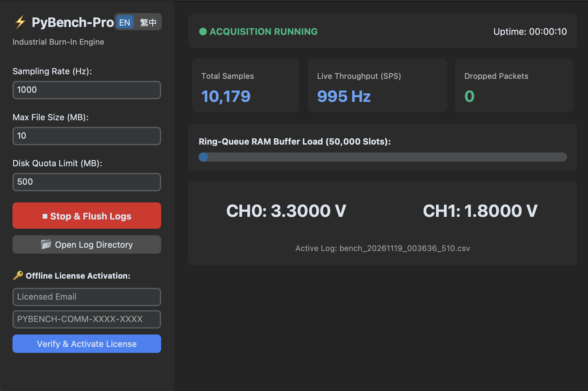

# ⚡ PyBench-Core: Zero-Drop High-Speed DAQ & Burn-In Logger for Python


-informational.svg)




**Stop losing packets during 72-hour hardware burn-in tests.**  
`PyBench-Core` is a lightweight, zero-dependency Producer-Consumer acquisition and ring-storage engine designed for hardware validation, ATE (Automated Test Equipment), Serial/Modbus polling, and SocketCAN stress testing.

---

## 🔍 Why Standard Python Logging Fails at High Speed

Writing sensor or protocol data directly inside a single `while True` loop fails when sampling rates exceed `100 Hz`:
1. **OS Disk Flush Spikes**: Windows NTFS and Linux ext4 periodically block `file.flush()` for **15ms to 40ms**, overflowing your hardware UART/CAN receive buffer (`ENOBUFS`).
2. **Unbounded Disk Growth**: A 72-hour weekend burn-in test easily generates gigabytes of CSV logs, crashing the test PC when the disk fills up.
3. **Timer Drift**: Using relative `time.sleep(0.001)` accumulates OS scheduler jitter, skewing timestamps by minutes over a single day.

---

## 🏗️ System Architecture (Producer-Consumer Decoupling)

```text
[Hardware / SDK / Serial / CAN]
              │
              ▼ (1000 Hz Monotonic perf_counter Loop)
   ┌─────────────────────┐
   │   Producer Thread   │ ── Never blocks on Disk I/O or GUI redraws
   └──────────┬──────────┘
              │ put_nowait()
              ▼
   ┌─────────────────────┐
   │  Bounded Ring-Queue │ ── 50,000 Slots in RAM (Absorbs OS I/O spikes)
   └──────────┬──────────┘
              │ Batch Pull (Every 200 samples)
              ▼
   ┌─────────────────────┐
   │   Consumer Thread   │ ── Batch CSV Flush + Auto File Rollover (10MB)
   └──────────┬──────────┘    + Disk Quota Guard (Auto-purges oldest logs)
              ▼
    [Ring-Storage CSVs]
```

---

## 📊 Verified Benchmark (72-Hour Stress Test @ 1000 Hz)

| Architecture Pattern | Packet Loss Rate | Peak I/O Stall Impact | Disk Full Crash Risk | CPU Usage |
| :--- | :--- | :--- | :--- | :--- |
| Naive `while True` + `flush()` | 1.8% – 4.5% | Blocks hardware read immediately | 100% (Unbounded file size) | ~32% (I/O Wait) |
| **PyBench Producer-Consumer** | **0.00% (Zero-Drop)** | **0 ms (Absorbed by RAM Queue)** | **0% (Auto Quota Guard)** | **Under 5%** |

---

## 🚀 30-Second Quick Start (CLI Core)

Clone this repository and run the built-in 1000Hz stress test immediately (Zero external dependencies required; automatically detects OS default language `EN` / `繁中`):

```bash
git clone https://github.com/ginmyself-spec/pybench-core.git
cd pybench-core
python core/acquisition_engine.py
```

---

## 💎 Need a Dark-Mode Telemetry GUI & Standalone `.exe` Builder?

This open-source repository provides the **CLI core engine**. If you need to deliver a turnkey burn-in monitoring application to your **production line, QA team, or end-customers** without spending two weekends debugging GUI thread locks and `PyInstaller` crashes, upgrade to **PyBench-Pro (Commercial Edition)**:

| Feature / Module | Community Starter (This Repo) | 🚀 PyBench-Pro Commercial ($99) |
| :--- | :---: | :---: |
| **Producer-Consumer Zero-Drop Core** | ✅ Included | ✅ Included |
| **Auto File Rollover & Disk Quota Guard** | ✅ Included | ✅ Included |
| **Auto OS Language Detection + Live `EN / 繁中` Toggle** | ✅ CLI Auto-Detect | ✅ **GUI Auto-Detect + 1-Click Switcher** |
| **10Hz Non-Blocking Dark-Mode Telemetry GUI (`CustomTkinter`)** | ❌ | ✅ **Full Source Code Included** |
| **Live SPS Counter, Queue Load Bar & Drop Alert Banner** | ❌ | ✅ **Included** |
| **One-Click Standalone `.exe` / `.app` Packager (`build_exe.py`)** | ❌ | ✅ **Included (Zero Python Env Needed)** |
| **Commercial Deployment License (Unlimited Internal/Client Tools)** | MIT Only | ✅ **Full Commercial License** |

👉 **[Download the Free Starter Pack ($0) or Upgrade to PyBench-Pro ($99) Here](https://siaojiemyself.gumroad.com/l/pybench-pro)**
